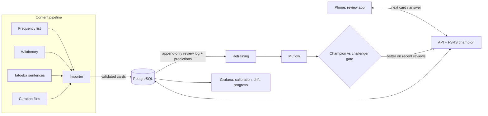

# forglemmigej 🌼

**A self-hosted Danish tutor whose scheduler is an ML model, with an MLOps loop around it.**

*Forglemmigej* is Danish for "forget-me-not". The app shows you Danish words in real
sentences and decides each day what you should review, by predicting how likely you
are to still remember each card. Every answer is new training data. A retrained
model only replaces the running one when it predicts your memory better, and that
is checked automatically. Everything runs on one small home server without a GPU.

> **Status: work in progress.** The learning app, the content pipeline and the
> deployment work today. Retraining, the champion/challenger gate and the
> dashboards are being built. See [Roadmap](#roadmap).

## Why this project

Most MLOps demos stop at "train a model, serve it". Spaced repetition is a good
setting for the parts that come after that:

- **The model makes the decision.** It decides what you review today; a better model means less time for the same retention.
- **Ground truth arrives immediately.** Every review is a label: remembered or not.
- **The world drifts.** After a holiday you forget differently; as you improve, new words stick faster.
- **A wrong model costs something.** Too-early reviews waste time; too-late ones mean forgetting. So a challenger has to prove itself before it is promoted.

## How it works



**Learning in context.** A learner cannot tell whether a flashcard is wrong, so
correctness is the pipeline's job. Every word is shown in a short, human-written
example sentence, and the sentence is only used if its English translation
confirms the word's meaning. Sentences that fit another word spelled the same way
are rejected (*ved* is "at", but also "knows"). Each word then gets two cards: one
for recognition (the sentence with the word highlighted) and one cloze card where
you type the missing word, which is checked automatically.

**The memory model.** For every card the model predicts the probability of recall
right now. A card is due when that probability would fall below 90%. The champion
is [FSRS](https://github.com/open-spaced-repetition/fsrs4anki), the algorithm used
by Anki. Challengers (FSRS fitted to my own reviews, then a LightGBM model with
features FSRS does not see, such as card type and response time) run in
**shadow mode**: they predict every review too, but do not schedule. So all
models are compared on exactly the same reviews.

**Rules that keep it honest:**

- The review log is append-only, enforced by a database trigger.
- Every feature uses only information from *before* the review it predicts.
- Train/test splits are chronological, never random.
- Training and serving share one feature function.

The full reasoning is in [docs/design.md](docs/design.md).

## Stack

| Layer | Choice |
|---|---|
| App | SvelteKit (SPA) · FastAPI · PostgreSQL |
| Memory model | FSRS (champion) · scikit-learn / LightGBM (challengers) |
| MLOps | MLflow · scheduled retraining · Evidently · Prometheus + Grafana |
| Platform | Debian 13 · k3s on one HP mini PC · Tailscale · GitHub Actions |

## Repository layout

| Path | What |
|---|---|
| `web/` | Review app (Svelte 5 + TypeScript, static build served by nginx) |
| `api/` | FastAPI backend, scheduling, content importer (Python, `uv`) |
| `data/curation/` | Hand-maintained word corrections and survival phrases |
| `deploy/` | Kubernetes manifests and deploy script ([deploy/README.md](deploy/README.md)) |
| `docs/` | Design notes |

## Run it locally

Prerequisites: Docker, Node.js, [uv](https://docs.astral.sh/uv/).

```bash
cp .env.example .env            # then set POSTGRES_PASSWORD
docker compose up -d            # PostgreSQL on 127.0.0.1:5432

cd api
uv run alembic upgrade head
uv run python -m forglemmigej_api.content.importer --download   # fetches the sources into data/raw
uv run uvicorn forglemmigej_api.app:app --reload                # API on :8000

cd web && npm install && npm run dev                            # app on :5173, proxies /api to :8000
```

Tests: `uv run pytest` in `api/` (needs the local PostgreSQL), `npm test` in `web/`.
To run the production images locally: `docker compose --profile app up --build`
(app on `http://localhost:8080`).

## Roadmap

- [x] Content pipeline: frequency list → dictionary entries → validated example sentences
- [x] Review app with FSRS scheduling; every review logged with the champion's prediction
- [x] Containers, k3s manifests, nightly database backup
- [ ] Deploy to the homelab, phone access over Tailscale
- [ ] Feature pipeline and the first challengers (pre-trained on public review logs)
- [ ] MLflow tracking and the champion/challenger gate in CI
- [ ] Grafana dashboards: calibration, drift, learning progress
- [ ] Public showcase on GitHub Pages: a published model report, then a try-it demo running fully in the browser
- [ ] Audio (Danish TTS), pronunciation practice (Whisper), an LLM helper for grammar questions

## Attribution

- Word frequencies: [FrequencyWords](https://github.com/hermitdave/FrequencyWords) by Hermit Dave, built from [OpenSubtitles 2018](http://opus.nlpl.eu/OpenSubtitles2018.php), [CC BY-SA 4.0](https://creativecommons.org/licenses/by-sa/4.0/).
- Meanings, gender, pronunciation and phrases: [Wiktionary](https://en.wiktionary.org/), via the [kaikki.org](https://kaikki.org/) extraction ([Wiktextract](https://github.com/tatuylonen/wiktextract)), [CC BY-SA 4.0](https://creativecommons.org/licenses/by-sa/4.0/).
- Example sentences and translations: [Tatoeba](https://tatoeba.org/), [CC BY 2.0 FR](https://creativecommons.org/licenses/by/2.0/fr/).

The downloaded data is not part of this repository.
